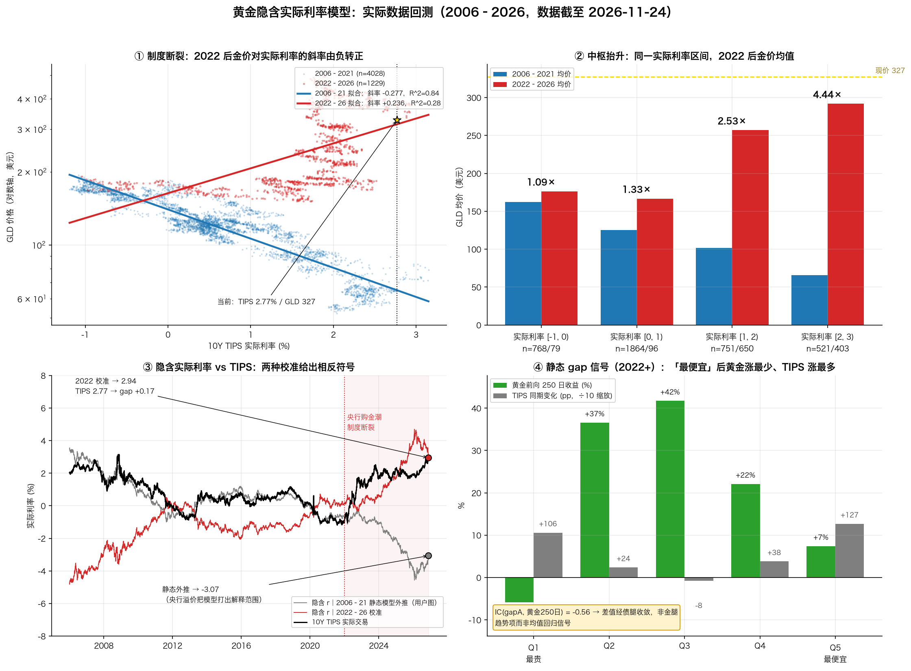

第二篇复现了「黄金隐含 4.12% 实际利率 vs TIPS 2.79%」这个读数，并发现 2022 年之后金价对实际利率的斜率由负转正。那一篇停在模型层面。这一篇问一个更直接的问题：**用这个模型的信号去交易，能赚钱吗？**

答案是不能，而且方向是反的。但同一个回测也把第二篇的制度断裂发现坐实了。这两件事同时成立，值得分开说。

*四联图。① 制度断裂散点：蓝点 2006–2021 沿下行线，红点 2022–2026 翻成上行线。② 同一实际利率区间，2022 后金价均值抬升 1.09 到 4.44 倍。③ 隐含实际利率 vs TIPS：灰线是 2006–2021 静态外推，已经跌到 −3；红线是 2022 校准，读数 2.94。④ 静态 gap 信号在 2022 年后的分位回测：最便宜的一组之后，黄金涨 7%，TIPS 涨 127 个基点。*

## 设计

四个模型，同一条数据（GLD + DFII10，2004 到 2026）。

**模型 A，静态外推。** 2006 到 2021 年拟合，之后不再更新。这是原观点图里的那条线，也是「1.5σ 便宜」的来源。2022 年之后天然是样本外。

**模型 B，滚动 365 日。** 每天用过去一年的数据重新拟合，只用 $t-1$ 及之前的数据。每天都有样本外的隐含利率。

**模型 D，制度哑变量。** 全样本拟合，2022 年后允许截距和斜率变化。

**信号。** gap = 隐含实际利率 − TIPS。gap 为正，黄金相对利率环境便宜。

**检验。** 按信号分五组，看前向 20、60、120、250 个交易日的黄金收益。同时看同期 TIPS 的变化，因为第二篇说过 gap 有三条收敛路径。

## 回测一：静态外推，2022 年之后

| 分位 | 60 日 | 120 日 | 250 日 | 同期 TIPS 60 日 | TIPS 250 日 |
| :--- | :--- | :--- | :--- | :--- | :--- |
| Q1 最贵 | −3.9% | −11.0% | −5.8% | +27.5 | +106.0 |
| Q2 | +13.7% | +25.2% | +36.6% | −5.4 | +23.9 |
| Q3 | +6.0% | +16.7% | +41.7% | −7.9 | −7.9 |
| Q4 | +4.2% | +6.3% | +22.1% | +24.4 | +38.1 |
| **Q5 最便宜** | **+0.1%** | **+1.4%** | **+7.4%** | +50.6 | **+126.8** |

IC（gap 与前向收益的相关系数）：20 日 −0.02，60 日 −0.13，120 日 −0.22，**250 日 −0.56**。

模型说「最便宜」的那 20% 的交易日，之后一年黄金只涨 7.4%，是五组里倒数第二。中间三组反而涨得多。而**同期 TIPS 涨了 127 个基点**，是五组里最多的。

读法：gap 确实收敛了，但主要是经债腿收敛的。模型喊便宜的时候，黄金不怎么涨，实际利率自己往上走，把差值填上了。

为什么？因为 2022 年之后静态 gap 的年度均值是单调发散的：−1.09 → −2.59 → −3.57 → −4.89 → −6.10。它不是一个围绕均值波动的估值偏离，是一个**趋势项**。「便宜」可以持续更便宜，而且越来越便宜。把趋势项当均值回归信号做，方向自然反。

## 回测二：滚动模型，2007 年之后

滚动模型每天重新校准，不会被趋势甩出量程。

| 分位 | 20 日 | 60 日 | 120 日 | 250 日 |
| :--- | :--- | :--- | :--- | :--- |
| Q1 最贵 | +0.6% | +2.1% | +4.1% | +16.5% |
| Q3 | +0.6% | +2.0% | +3.1% | +7.4% |
| **Q5 最便宜** | +1.1% | **+4.3%** | **+9.6%** | +15.1% |

IC 很弱：0.015 到 0.052，120 日最明显。Q5 在 120 日上有弱单调性，但 Q1 也涨——黄金二十年的长牛 beta 把信号淹没了。

### 极端信号

| 阈值 | 事件数 | 60 日 | 120 日 | 250 日 |
| :--- | :--- | :--- | :--- | :--- |
| z ≥ 1.0 | 45 | +1.6% / 胜率 56% | +4.8% / 62% | +10.0% / 60% |
| **z ≥ 1.5** | 38 | +2.6% / 58% | **+5.6% / 63%** | +11.4% / 58% |
| z ≥ 2.0 | 27 | +1.5% / 52% | +4.8% / 63% | +9.8% / 56% |

事件去重间隔 60 日。z ≥ 1.5 有 38 次事件，120 日平均涨 5.6%，胜率 63%。这是一个**边际的正期望**，但 z ≥ 2.0 不比 1.5 好，没有单调性。胜率 63% 算不上强信号。

最近一次触发是 2026 年 10 月 22 日。

## 同一组数据，两件事同时成立

把回测结果和第二篇的发现放在一起。

**被证伪的。** 「隐含实际利率高于 TIPS 1.5σ，所以黄金便宜，会涨」这个推论。静态模型的 250 日 IC 是 −0.56，TIPS 才是收敛的主通道。一个估值偏离在趋势中可以持续扩大，「便宜」本身不构成买入理由。

**被坐实的。** 「2022 年央行购金潮之后，黄金对实际利率的定价机制变了」。散点图的斜率从 −0.277 翻到 +0.236，R² 从 0.84 崩到 0.21，中枢抬升随实际利率升高而放大到 4.4 倍。这些是数据的客观属性，和用哪个窗口拟合无关。

这两件事不矛盾。第一件说的是：**估值信号在制度转换期不可靠**。第二件说的是：**制度本身确实变了**。正因为制度在变，用旧制度校准的估值信号才会失效。

## 四个模型风险的实证回答

第二篇列了四个风险，回测逐个给答案。

**σ 的口径。** 极度敏感。训练期 σ 给出 z = −13.7，没有意义；滚动 252 日给出 +0.86；滚动 756 日给出 −0.98。「1.5σ」没有一个稳定的读数。

**溢价时变。** 不只是时变，是持续扩大。固定哑变量低估了 2025 到 2026 年的溢价。

**TIPS 内生。** 实锤。「最便宜」之后 TIPS 250 日 +127 个基点。

**流动性主导。** 60 日胜率只有 58%，短期噪声大。需要结合融资压力指标过滤。

## 弱判断，第三版

三篇下来，弱判断改了两次。

| 项 | 第一版（宏观） | 第二版（模型） | 第三版（回测） |
| :--- | :--- | :--- | :--- |
| 中期 6 到 18 月 | 偏上，中置信，依据「流量与仓位」 | 偏上，中高置信，依据「1.5σ 便宜」 | **偏上，中高置信，依据改回「利率脱敏 + 中枢抬升」** |
| 当前位置 | — | 便宜 | **略高于同利率区间的 2022 后中枢，不便宜** |
| 短期 0 到 3 月 | 震荡偏下 | 不变 | **不变，「便宜」在趋势中会持续更便宜** |
| 可跟踪量 | 融资压力、CTA、央行节奏 | 隐含 − TIPS gap | **滚动 120 日 gap（唯一弱单调口径）、2022 后滚动 R²、TIPS 方向** |

第二版把置信度提到中高，依据是「1.5σ 便宜」。第三版把依据换掉了，但置信度没降，因为换上来的依据更硬：不是「价格偏离了模型」，而是「模型本身的结构变了」。

中期偏上的理由应该是：**利率上行对金价的压制，被央行制度结构性削弱了。** 不是「黄金便宜」。

## 这条线现在站在哪儿

一句话：**金价跌了 37%，央行制度没变，估值模型的信号不可靠，弱判断维持但依据换了。**

| 想做什么 | 能不能用这个模型 |
| :--- | :--- |
| 判断黄金是否处于结构性牛市 | 能。斜率转正、中枢抬升、央行节奏，三个指标都指向「是」 |
| 判断当前是否便宜 | 不能。gap 是趋势项，σ 口径不稳定 |
| 做 120 日以内的方向交易 | 弱能。滚动模型 z ≥ 1.5 有 5.6% 的边际期望，胜率 63% |
| 做 250 日的方向交易 | 不能。静态 IC −0.56，滚动 IC 0.015 |
| 监测制度是否松动 | 能。滚动 R² 和斜率是最早的指标 |

## 还没做完的

| 优先级 | 内容 | 状态 |
| :--- | :--- | :--- |
| **P0** | 央行购金流量作为显式变量进回归，替代哑变量 | ⬜ 计划 |
| **P1** | 结构性断裂检验（Chow、Bai-Perron）确认斜率反转的显著性 | ⬜ 计划 |
| **P1** | 加美元指数和盈亏平衡通胀做双变量模型 | ⬜ 计划 |
| **P2** | 用 SOFR、交叉货币基差过滤流动性事件，看极端信号的胜率能否提升 | ⬜ 计划 |

## 方法论备注

- 前向收益按交易日计算。事件研究去重间隔 60 日。
- 滚动模型无未来函数。静态模型的 2022 年后段落天然样本外。
- 这是估值信号回测，不是交易策略。不含成本、滑点、仓位管理。
- 用 GLD 代理现货金价，跟踪误差在 0.4% 每年以内。

## 代码与数据

- [backtest.py](/assets/code/gold/backtest.py)：四个模型的拟合与回测
- [plot.py](/assets/code/gold/plot.py)：四联图
- [backtest_daily.csv](/assets/code/gold/backtest_daily.csv)：2006 年起的逐日信号与前向收益，5,257 行

## 来源

- FRED：DFII10、DGS10、T10YIE
- Yahoo Finance：GLD
- 高盛：GLD 看涨期权与金价放大效应
- 本专题第一篇、第二篇
