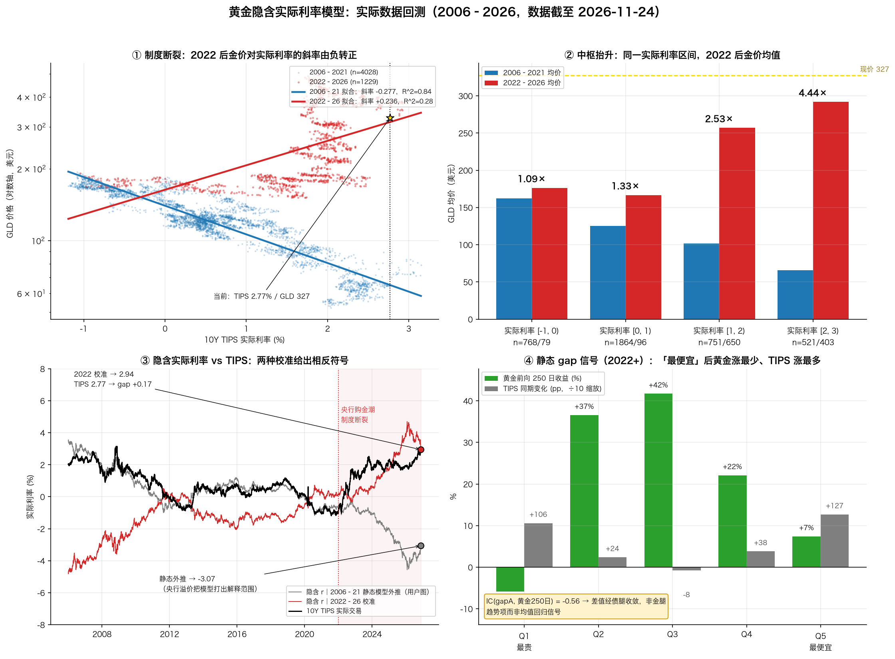



2026 年 1 月黄金创下 5,600 美元的纪录，11 月跌到 3,500，回撤 37%。同一时间，全球央行每个季度买 300 多吨，实物 ETF 持仓在创纪录。
谁在卖，谁在买，为什么能同时发生。这个专题从债务流动性开始，把因果链拆到利率，再用一个估值模型给「贵还是便宜」算个数，最后把那个模型拿去回测，发现它的信号方向是反的。

这条线共 {{ parts.size }} 篇。第一篇是定性的，讲债务流动性和黄金的两种属性怎么打架。第二篇是定量的，复现一个「隐含实际利率」模型，过程中发现 2022 年之后金价对利率的斜率由负转正。第三篇是证伪，用二十年数据回测，把「便宜」和「会涨」分开。

## 导读

- **结论**：第三篇的「这条线现在站在哪儿」那张表，列了这个模型能做什么、不能做什么。
- **正序推导**：第一篇给出因果链和弱判断，第二篇把弱判断的依据换成估值，第三篇再把依据换回去。
- **被推翻的假设**：「隐含利率高于 TIPS 1.5σ，所以黄金便宜会涨」。第三篇的 250 日 IC 是 −0.56。
- **被坐实的发现**：央行购金潮之后，金价对实际利率的斜率由 −0.28 翻到 +0.24，R² 从 0.84 崩到 0.21。这个和用哪个窗口拟合无关。

## 目录

<ul class="series-index">
  
  <li class="series-index-item">
    <a href="{{ p.url | relative_url }}">
      {{ p.series_part | prepend: "0" | slice: -2, 2 }}
      {{ p.nav_title | default: p.title }}
      →
    </a>
    
{{ p.excerpt | default: p.description | strip_html | strip_newlines | truncate: 140 }}

  </li>
  
</ul>

## 先看图，再往下读

左上那张是最重要的一幅。蓝点是 2006 到 2021 年，沿着一条清晰的下行线：实际利率越高，金价越低。红点是 2022 到 2026 年，整体上移，翻转成上行线。金星是 2026 年 11 月 24 日的位置。

右上：同一个实际利率区间，红柱比蓝柱高 1.1 到 4.4 倍，抬升幅度随利率升高而放大。

左下：灰线是 2006 到 2021 年静态模型外推的隐含利率，已经跌到 −3，被央行溢价打出了解释范围。红线是 2022 年校准，读数 2.94。同一个金价，两种校准，相反的符号。

右下：用静态模型的「便宜」信号在 2022 年后做多头，最便宜的一组之后黄金涨 7%，TIPS 涨 127 个基点。

## 这条线现在站在哪儿

| 想回答的问题 | 当前的答案 | 依据 |
| :--- | :--- | :--- |
| 这轮下跌是牛市结束吗 | 更像结构性牛市中的流动性回撤 | 央行节奏未断、实物 ETF 未赎回、生产商净空距 2013 年大底信号只差 4,500 手 |
| 根变量是什么 | 债务流动性，油价是它的通胀表达 | AI 债务化 9% → 32%、主权利息自我强化、美元荒蔓延股债 |
| 现在便宜吗 | 不便宜 | TIPS 2.77% 落在 [2, 3)，该区间 2022 后均值 292，现价 327 |
| 能用估值模型做方向交易吗 | 短期弱能，中期不能 | 滚动 120 日 z ≥ 1.5 有 +5.6% 边际期望；静态 250 日 IC −0.56 |
| 弱判断 | 短期震荡偏下，中期偏上，置信中高 | 依据是「利率脱敏 + 中枢抬升」，不是「便宜」 |

## 怎么读「弱判断」

这里的弱判断不是一个预测。它是一个条件化的倾向，附带着置信度和**可以被推翻的条件**。

三篇下来，倾向没变，但依据换了两次。第一篇靠资金流和仓位的故事，第二篇靠「1.5σ 便宜」，第三篇回测发现「便宜」的信号方向是反的，于是把依据换成了「模型结构变了」。置信度没有因为依据换了而下降，因为换上来的东西更硬。

这种写法是有意的：一个判断的价值不在于它对不对，在于它能不能被检验、能不能在证据变化时更新。

## 还没做完的

| 优先级 | 内容 | 状态 |
| :--- | :--- | :--- |
| **P0** | 央行购金流量作为显式变量进回归，替代 2022 年哑变量 | ⬜ 计划 |
| **P1** | 结构性断裂检验（Chow、Bai-Perron）确认斜率反转的显著性 | ⬜ 计划 |
| **P1** | 量化美元荒：SOFR 与 IORB 利差、交叉货币基差 | ⬜ 计划 |
| **P2** | 用融资压力指标过滤流动性事件，看极端信号胜率能否提升 | ⬜ 计划 |

## 数据与代码

- 数据：FRED 的 DFII10（10 年 TIPS）、DGS10（10 年名义）、T10YIE（盈亏平衡）；Yahoo Finance 的 GLD
- 代码：[backtest.py](/assets/code/gold/backtest.py)、[plot.py](/assets/code/gold/plot.py)
- 逐日信号：[backtest_daily.csv](/assets/code/gold/backtest_daily.csv)

## 一个方法论备注

第二篇最初算出隐含利率是 −3.07，和原观点的 +4.12 符号相反。花了几轮才定位到原因：训练窗口不同。用 2006 到 2021 年的模型解释 2026 年的金价，反解出来的利率必然是负的，因为金价超出了模型的量程。

这个负数本身没有经济含义。但它是一个有用的信号：当一个模型反解出量程之外的值，说明模型的结构假设已经失效，而不是市场出现了极端机会。

同一组数据，两种校准，相反的符号。「隐含实际利率」不是一个客观的市场属性，它是模型设定的产物。这一点比任何一个具体的读数都重要。
